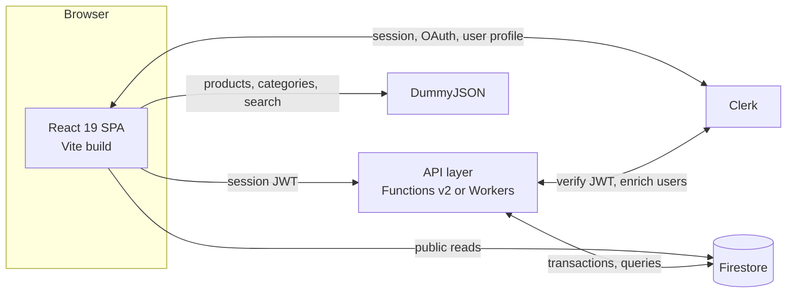
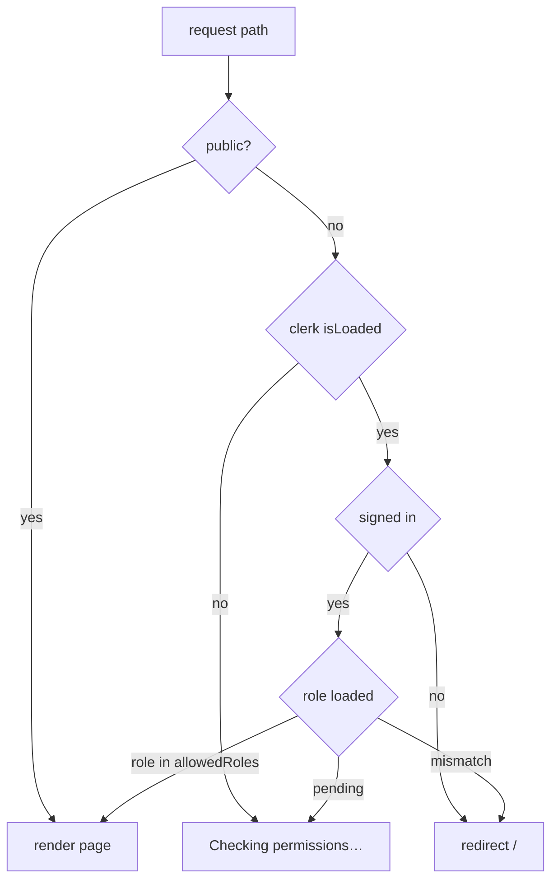
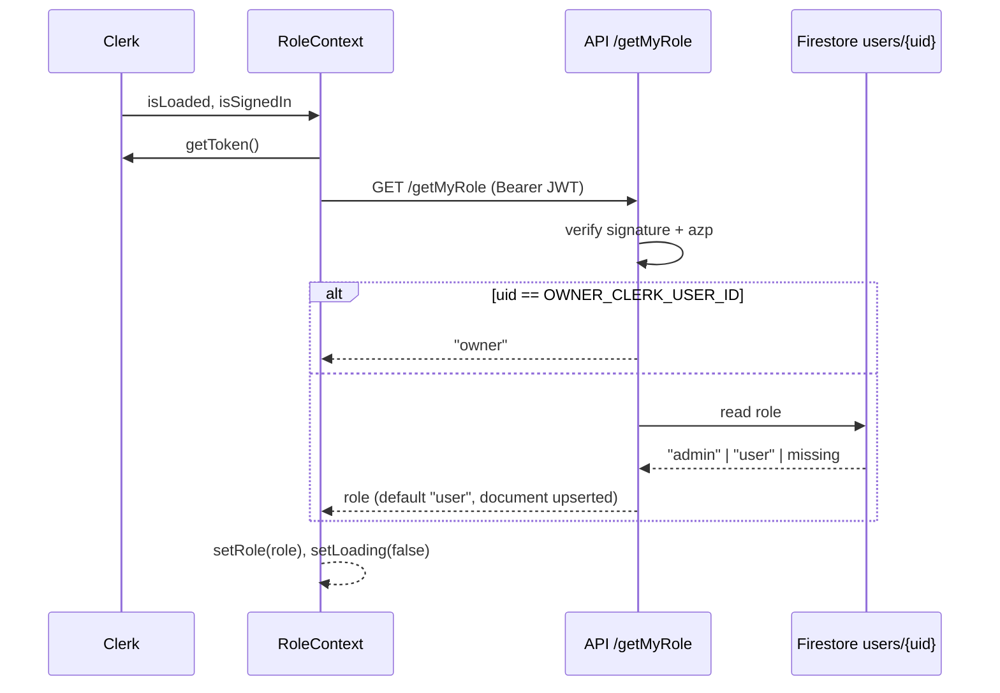
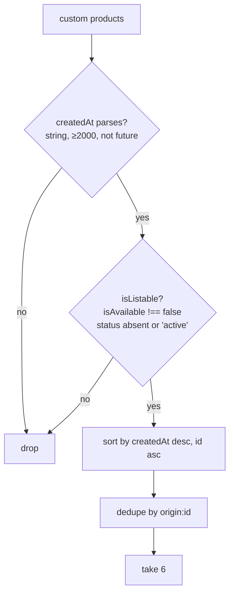
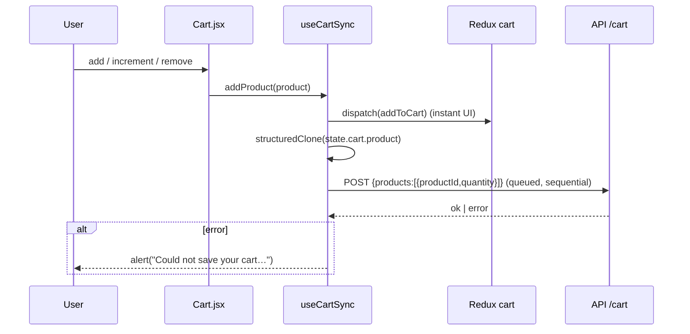
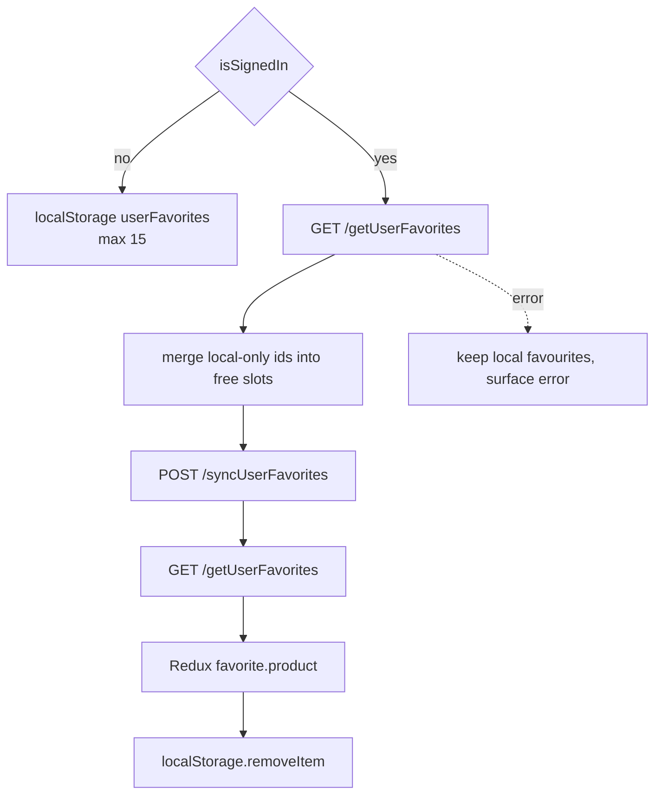
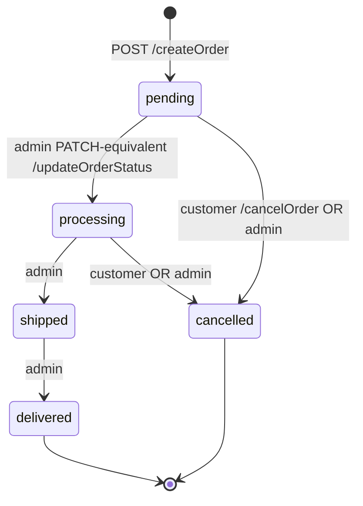

# Architecture — Al-Haidara storefront

Everything in this document maps to files in this repository. Diagrams are derived from the real
call paths, not from a generic template.

---

## 1. System context



Two interchangeable API implementations exist and share the same request/response contract:

| Implementation | Entry point | Notes |
| --- | --- | --- |
| Firebase Cloud Functions v2 | `functions/index.js` | 25 `onRequest` exports, Node 22, secrets via Secret Manager, needs the Blaze plan |
| Cloudflare Workers | `workers/src/index.js` + `src/api.js` | Same handlers ported by `workers/build/port.mjs`, Firestore reached over REST, `AsyncLocalStorage` supplies `env`/`db` |

The frontend is unaware of which one answers; it only knows `VITE_API_BASE_URL`
(`src/services/apiBase.js`), which falls back to the local emulator.

## 2. Frontend layers

```
main.jsx
 ├─ BrowserRouter            (react-router 7)
 ├─ ClerkProvider            (@clerk/react)
 ├─ Redux Provider           (six slices)
 ├─ CartLoader   → useLoadCart()
 ├─ FavoritesLoader → useFavoritesSync({ initialize: true })
 └─ App.jsx
     └─ RoleProvider (context/RoleContext)
         └─ Routes
             ├─ RootLayout → Navbar + Outlet + Footer + ScrollButtons
             │    ├─ ContainedLayout → favorite, cart, checkout, admin/*, owner/*, my-orders
             │    └─ BleedLayout     → / (Home), /products
             └─ ProtectedRoute(allowedRoles)
```

Dependency direction is one-way: `Page → components/hooks → app (Redux) → services → API`.
No service imports a component, and no component calls `fetch` directly except the two Redux
thunks (`allProductSlice`, `productDetailsSlice`, `searchSlice`) that talk to DummyJSON.

## 3. Routing and guards



`ProtectedRoute` performs the client-side gate. The same decision is repeated on the server for every
mutation, because the client gate is only a UX affordance.

## 4. Role resolution



`updateUserRole` is owner-only and refuses `owner` as a target value, so privilege can only move
between `user` and `admin`.

## 5. Product data flow

```mermaid
flowchart LR
  subgraph External
    DJ[DummyJSON<br/>/products, /category, /search]
  end
  subgraph Firestore
    CP[(customProducts)]
  end
  UC[hooks/useCatalog] --> DJ
  UC -->|GET /getCustomProducts<br/>status == active| CP
  UC --> MERGE[merge + namespace<br/>origin:id]
  MERGE --> STORE[(Redux: allProducts)]
  STORE --> HOME[Home / New Arrivals]
  STORE --> PROD[/products]
  STORE --> DET[/productDetails/:id]
```

Key rule: identifiers are namespaced (`dummyjson:1` vs `custom:looz`), so cart lines, favourites and
order items can reference either origin without collision. `ProductDetails` resolves an id by first
asking the public custom-product endpoint and only then falling back to DummyJSON.

## 6. New Arrivals selection



Implemented in `src/utils/catalogSelectors.js`; the component re-sorts defensively and renders the
real count, the date range and the per-card "Added …" label.

## 7. Top Products ("Product of the Week")

```
categories = [groceries, furniture, fragrances, beauty]   (fixed in TopProducts.jsx)
selected  -> dispatch(fetchCategoryProducts(slug)) -> Redux categoryProducts[slug]
          -> filter(p => p.rating > 2.5)
          -> Swiper marquee (loop only when >= 3 items; slides repeated to reach 8 for loop mode)
```

No order or sales data participates in this section. The subtitle "Product of the week" is
merchandising language, not a computed ranking.

## 8. Cart data flow



The queue (`saveQueue.current`) serialises writes so rapid clicks cannot land out of order; only the
latest task clears the saving indicator. Loading is one-shot per session (`useLoadCart`).

## 9. Favourites data flow



## 10. Order lifecycle



`createOrder` recomputes the total from Firestore product data on the server, so a tampered client
total cannot be persisted. Each transition writes a `userActivity` document.

## 11. Firestore model

```
users/{uid}                        { role }
users/{uid}/favorites/{favId}      { productId, title, price, image, ... }
customProducts/{id}                { title, category, brand, tags, price, discountPercentage,
                                     rating, stock, description, shippingInformation,
                                     images[], status, createdAt }
carts/{uid}                        { products:[{productId,quantity}], updatedAt }
orders/{id}                        { orderId, userId, customer, items[], totalAmount,
                                     shippingInformation, paymentMethod, status,
                                     createdAt, updatedAt, cancelledAt?, cancelledBy? }
userActivity/{id}                  { userId, userName, type, message, entityId,
                                     entityType, metadata, createdAt }
```

## 12. API surface

| Area | Endpoint | Auth | Role |
| --- | --- | --- | --- |
| Health | `GET /api` | none | — |
| Session | `GET /authCheck` | JWT | any |
| Role | `GET /getMyRole` | JWT | any |
| Role | `POST /updateUserRole` | JWT | owner |
| Cart | `GET /cart`, `POST /cart` | JWT | any |
| Favourites | `GET /getUserFavorites`, `POST /addUserFavorite`, `DELETE /removeUserFavorite`, `POST /syncUserFavorites` | JWT | any |
| Orders | `POST /createOrder`, `GET /getOrder`, `GET /getMyOrders`, `POST /cancelOrder` | JWT | any (own data) |
| Orders | `GET /getAllOrders`, `POST /updateOrderStatus` | JWT | admin/owner |
| Orders | `GET /getOwnerDeliveredRevenue` | JWT | owner |
| Users | `GET /getAllUsers` | JWT | owner |
| Products | `GET /getCustomProducts` | none | — |
| Products | `GET /getAdminCustomProducts` | JWT | admin/owner |
| Products | `POST /createCustomProduct`, `PUT /updateCustomProduct`, `DELETE /ArchivedCustomProduct`, `DELETE /deleteCustomProduct` | JWT | admin/owner |
| Activity | `GET /getAllUserActivities`, `GET /getUserActivities` | JWT | admin/owner |

## 13. Deployment topologies

```
A. Firebase-native                     B. Free-tier (current deployment)
  Vercel/Pages ── SPA                    Vercel/Pages ── SPA
      │                                      │
      ▼                                      ▼
  Functions v2 (Blaze)  ←→ Firestore     Cloudflare Worker  ←REST→ Firestore
      └─ Secret Manager                      └─ Wrangler secrets
```

Both require `OWNER_CLERK_USER_ID` and an `ALLOWED_ORIGINS` list that matches the exact frontend
origin, because the same list doubles as the Clerk `azp` allow-list.

## 14. Known architectural limits

- No caching layer in front of Firestore; each page load re-reads its collection.
- Image payloads are base64 data URLs inside the product document, which inflates document size and
  response time (visible as the slow first paint on `/productDetails/:id`).
- The worker's 10 ms CPU budget on the free plan bounds `getAllOrders` and activity pagination.
- Guest carts are Redux-only; there is no anonymous cart persistence.
